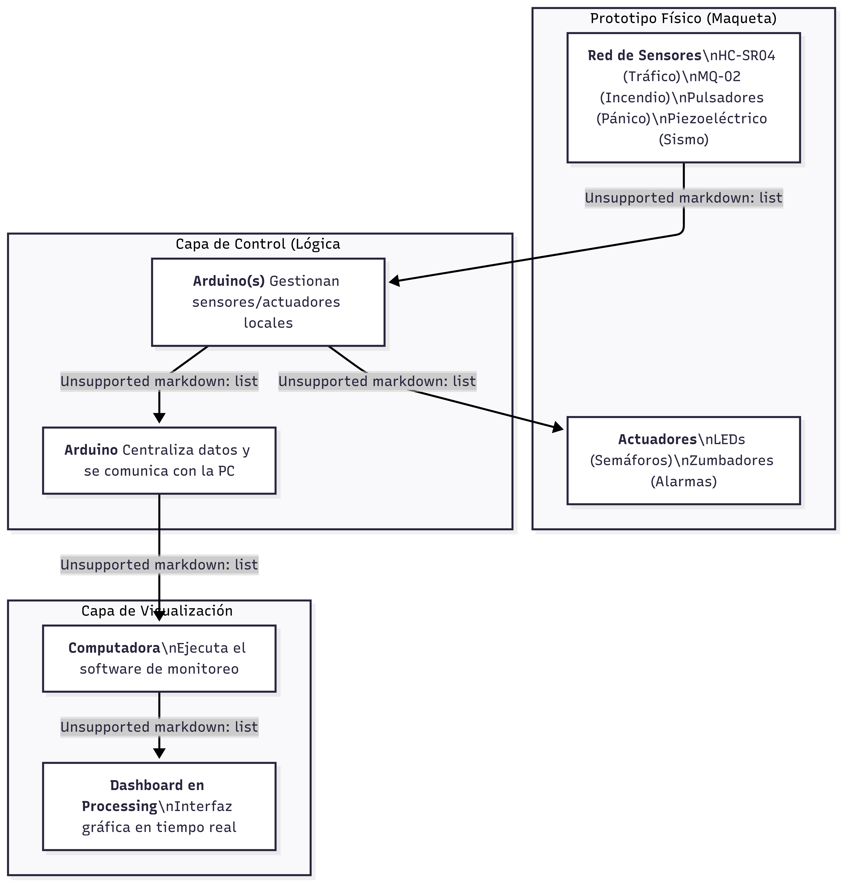
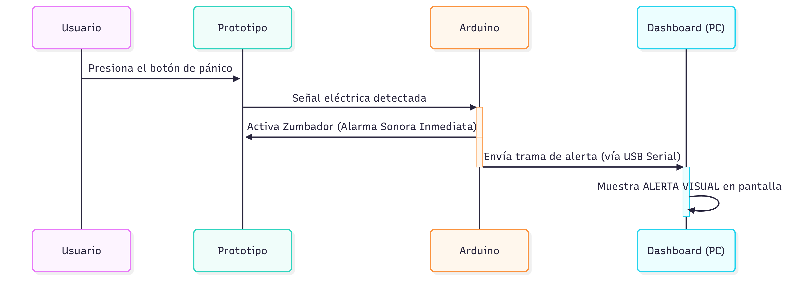
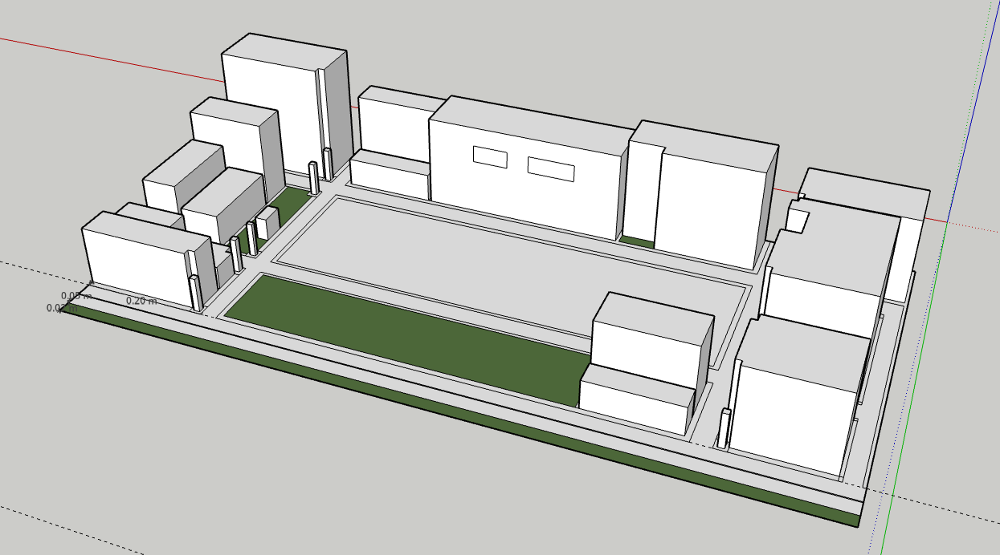

# Documento de Diseño y Arquitectura del Sistema
## Proyecto: Gestión Inteligente de Tráfico y Seguridad Ciudadana (Fase 1)

**Versión:** 1.0
**Fecha:** 21 de agosto de 2025
**Autores:**

---

## Índice

- [Documento de Diseño y Arquitectura del Sistema](#documento-de-diseño-y-arquitectura-del-sistema)
  - [Proyecto: Gestión Inteligente de Tráfico y Seguridad Ciudadana (Fase 1)](#proyecto-gestión-inteligente-de-tráfico-y-seguridad-ciudadana-fase-1)
  - [Índice](#índice)
    - [1. Resumen Ejecutivo](#1-resumen-ejecutivo)
    - [2. Introducción](#2-introducción)
      - [2.1. Justificación y Planteamiento del Problema](#21-justificación-y-planteamiento-del-problema)
      - [2.2. Objetivos del Proyecto](#22-objetivos-del-proyecto)
        - [**Objetivo General:**](#objetivo-general)
        - [**Objetivos Específicos:**](#objetivos-específicos)
    - [3. Alcance y Delimitaciones (Fase 1)](#3-alcance-y-delimitaciones-fase-1)
      - [3.1. Alcance Funcional](#31-alcance-funcional)
      - [3.2. Delimitaciones y Exclusiones](#32-delimitaciones-y-exclusiones)
    - [4. Arquitectura del Sistema](#4-arquitectura-del-sistema)
      - [4.1. Arquitectura de Hardware](#41-arquitectura-de-hardware)
      - [4.2. Arquitectura de Software](#42-arquitectura-de-software)
      - [4.3. Flujo de Datos y Comunicación](#43-flujo-de-datos-y-comunicación)
    - [5. Metodología de Desarrollo](#5-metodología-de-desarrollo)
  - [Diagramas](#diagramas)
  - [Link de Github](#link-de-github)
  - [Link de la simulacion](#link-de-la-simulacion)
  - [6. Descripción Detallada del Prototipo Físico](#6-descripción-detallada-del-prototipo-físico)
    - [6.1. Diseño y Construcción de la Maqueta](#61-diseño-y-construcción-de-la-maqueta)
    - [6.2. Integración Electrónica y Cableado](#62-integración-electrónica-y-cableado)
    - [6.3. Detalles de Funcionamiento](#63-detalles-de-funcionamiento)
    - [6.4. Usos y Beneficios del Prototipo](#64-usos-y-beneficios-del-prototipo)
      - [Usos:](#usos)
      - [Beneficios:](#beneficios)

---

### 1. Resumen Ejecutivo

Este documento detalla el diseño, la arquitectura y el alcance de la **Fase 1** del proyecto "Sistema de Gestión Inteligente de Tráfico y Seguridad Ciudadana". El proyecto busca abordar los desafíos de movilidad y seguridad en el Centro Histórico de la Zona 1 de Guatemala mediante un prototipo a escala basado en tecnologías de Internet de las Cosas (IoT).

En esta fase inicial, el sistema se enfoca en el **monitoreo y la visualización local de datos**. Se implementará un prototipo físico que simula varias cuadras, intersecciones, paradas de transporte público y sitios históricos. Una red de sensores (ultrasónicos, de gas, piezoeléctricos) recolectará datos en tiempo real, los cuales serán procesados por una arquitectura de microcontroladores Arduino en configuración Master-Slave.

La información consolidada será enviada a una estación de monitoreo (computadora) a través de comunicación serial y visualizada en un **dashboard interactivo desarrollado en Processing**. Este sistema permitirá supervisar el estado de los semáforos, el flujo del transporte público y activar alertas audibles locales para incidentes como incendios, sismos o pánicos, sentando así las bases para futuras fases que integrarán Inteligencia Artificial y conectividad remota.

---

### 2. Introducción

#### 2.1. Justificación y Planteamiento del Problema

El Centro Histórico de la Ciudad de Guatemala, como núcleo de gran valor patrimonial y alta densidad poblacional, enfrenta constantes desafíos en materia de movilidad urbana y seguridad ciudadana. La congestión vehicular, la gestión de emergencias y la necesidad de una respuesta rápida a incidentes de seguridad demandan soluciones tecnológicas innovadoras. Los sistemas tradicionales de gestión son a menudo reactivos y carecen de la capacidad de recopilar y analizar datos en tiempo real para una toma de decisiones proactiva.

Este proyecto se justifica por la necesidad de explorar y validar un modelo de "Ciudad Inteligente" a escala, utilizando tecnología accesible como IoT, que permita sentar las bases para un entorno urbano más seguro, eficiente y resiliente.

#### 2.2. Objetivos del Proyecto

##### **Objetivo General:**

Diseñar, construir e implementar un prototipo funcional a escala de un sistema de monitoreo local para la gestión del tráfico y la seguridad ciudadana, utilizando una red de sensores controlada por microcontroladores Arduino y una interfaz de visualización en Processing.

##### **Objetivos Específicos:**

1.  **Construir** el prototipo físico (maqueta) que represente el entorno urbano simulado, incluyendo semáforos, rutas de transporte y puntos de interés.
2.  **Integrar** los componentes de hardware, incluyendo sensores de distancia, humo, sismo y botones de pánico, con una arquitectura de control distribuido Master-Slave.
3.  **Desarrollar** el firmware en `Arduino IDE` para la adquisición de datos de los sensores, la gestión de actuadores (LEDs, zumbadores) y la comunicación vía protocolo I2C y serial.
4.  **Crear** una aplicación de escritorio en `Processing IDE` que funcione como dashboard para visualizar en tiempo real los datos recibidos del prototipo.
5.  **Validar** el funcionamiento de los sistemas de alerta temprana para infracciones, incendios, sismos y pánico a través de notificaciones visuales y sonoras locales.

---

### 3. Alcance y Delimitaciones (Fase 1)

#### 3.1. Alcance Funcional

* **Simulación de Tráfico:** El sistema controlará un mínimo de dos intersecciones con semáforos y simulará el recorrido de dos rutas de transporte público (Transmetro y Transurbano) a lo largo de un circuito cerrado.
* **Monitoreo de Sensores:** El sistema leerá y procesará datos de:
    * Sensores ultrasónicos (`HC-SR04`) para detectar el paso de vehículos y medir la distancia a paradas.
    * Sensores de gas (`MQ-02`) para la detección de posibles incendios en 2 sitios históricos.
    * Un sensor piezoeléctrico para la simulación de detección de sismos.
    * Múltiples botones de pánico para la activación manual de alertas.
* **Sistema de Alertas Locales:** Activación de alarmas sonoras (zumbadores) y visuales (en el dashboard) de forma inmediata tras la detección de una anomalía (infracción, incendio, sismo, pánico).
* **Visualización Centralizada:** Toda la información será presentada de forma gráfica y en tiempo real en un dashboard desarrollado en Processing, que se ejecutará en una computadora conectada directamente al prototipo vía USB.

#### 3.2. Delimitaciones y Exclusiones

Para mantener el enfoque en los objetivos de esta fase, las siguientes tecnologías y funcionalidades están **explícitamente fuera del alcance**:

* **No se utilizará Raspberry Pi.** La lógica de control reside exclusivamente en los microcontroladores Arduino.
* **No se implementarán algoritmos de Inteligencia Artificial.** No habrá procesamiento de video, reconocimiento facial, de matrículas o de objetos.
* **No habrá conectividad a Internet o redes inalámbricas.** La comunicación es estrictamente local y por cable (USB Serial).
* **No se utilizará comunicación MQTT, ni se desarrollará una API o base de datos.** Los datos son efímeros y solo se visualizan en tiempo real.
* **No se desarrollará una aplicación móvil (Flutter).** El único punto de monitoreo es el dashboard en Processing.

---

### 4. Arquitectura del Sistema

#### 4.1. Arquitectura de Hardware

El sistema se basa en una arquitectura de control distribuido para garantizar la modularidad y escalabilidad.

* **Arduino Master:** Actúa como el cerebro del sistema. Su función es centralizar la información recibida de los nodos esclavos, tomar decisiones globales (como registrar una alerta) y gestionar la comunicación serial con la computadora que ejecuta el dashboard.
* **Red de Sensores y Actuadores:** Los sensores (HC-SR04, MQ-02, etc.) y actuadores (LEDs, zumbadores) están conectados a los Arduinos , que se encargan de su lectura y activación directa.

#### 4.2. Arquitectura de Software

El software se divide en dos componentes principales que operan en tándem:

* **Firmware de Arduino (C/C++ en Arduino IDE):**
    * **Lógica del Master:** Programa que sondea constantemente , recibe y decodifica sus mensajes, y traduce esta información a una trama de datos simple (ej. una cadena de texto separada por comas) que envía a través del puerto serie (USB).

* **Dashboard de Visualización (Java en Processing IDE):**
    * **Receptor Serial:** El programa escucha activamente el puerto serie para recibir los datos enviados por el Arduino Master.
    * **Parser de Datos:** Una vez recibida la trama de datos, se divide y se interpreta para actualizar las variables internas del programa (ej. estado del semáforo 1, nivel de humo del sensor 2, etc.).
    * **Motor de Renderizado Gráfico:** Utiliza las funciones gráficas de Processing para dibujar y actualizar en tiempo real el estado del sistema en la pantalla, incluyendo mapas, indicadores, gráficos y alertas.

#### 4.3. Flujo de Datos y Comunicación

El flujo de información sigue una secuencia lógica y jerárquica:

1.  **Captura:** Los sensores en el prototipo capturan un evento físico (movimiento, humo, etc.).
2.  **Procesamiento Local:** El Arduino más cercano lee el sensor, interpreta el dato y, si es necesario, activa una respuesta local inmediata (ej. un zumbador).
3.  **Consolidación:** El arduino recibe la información y la agrega a su estado general del sistema.
4.  **Transmisión:** El arduino envía el estado actualizado del sistema a la computadora a través del puerto USB-Serial.
5.  **Visualización:** El programa en Processing recibe, interpreta y muestra la información en el dashboard para el supervisor.

---

### 5. Metodología de Desarrollo

El proyecto se ejecutará siguiendo una metodología iterativa, dividida en las siguientes etapas:

1.  **Fase 1: Diseño y Planificación:** Definición detallada de los requisitos, selección final de componentes y diseño de los circuitos electrónicos y la maqueta.
2.  **Fase 2: Montaje del Prototipo:** Ensamblaje físico de la maqueta, instalación de todos los sensores, actuadores y cableado de los microcontroladores.
3.  **Fase 3: Desarrollo de Software:**
    * Programación y prueba individual.
    * Desarrollo incremental del dashboard en Processing.
4.  **Fase 4: Integración y Pruebas:** Conexión de todos los subsistemas (hardware y software) y realización de pruebas integrales para verificar que el sistema cumple con todos los objetivos funcionales definidos.

---
## Diagramas 

## Link de Github

https://github.com/Ennero/ARQUI2B_2S2025_GA1

## Link de la simulacion      

https://app.sketchup.com/share/tc/northAmerica/aJ2IbRWgOl0?stoken=XyzgiDlDwOA2tYNCufjUEXr-pC4gbiujco70CVSAYh1IWYxRf9vRuN2l5BS9yo0-&source=web

## 6. Descripción Detallada del Prototipo Físico

El prototipo físico es el componente central de la Fase 1 del proyecto, sirviendo como una representación tangible y funcional del sistema de monitoreo propuesto. A continuación, se detallan sus características, funcionamiento y beneficios.

### 6.1. Diseño y Construcción de la Maqueta

La maqueta ha sido construida a escala para representar un sector del Centro Histórico de la Zona 1 de Guatemala. Se utilizaron materiales de bajo costo como cartón y elementos impresos para modelar los edificios, calles, paradas de autobús y puntos de interés histórico. El diseño busca no solo ser funcional, sino también visualmente representativo del entorno que se pretende monitorear, 

El modelo incluye elementos clave como edificios emblemáticos, rutas de transporte público simuladas y la distribución de banderas que refuerzan el contexto geográfico del proyecto.

### 6.2. Integración Electrónica y Cableado

El verdadero cerebro del prototipo reside bajo la superficie.  un complejo sistema de cableado interconecta todos los componentes electrónicos. Este "sistema nervioso" es responsable de llevar la energía y los datos entre los microcontroladores Arduino y la red de sensores y actuadores distribuidos por toda la maqueta.
Cada grupo de cables conecta un componente específico:

- Sensores ultrasónicos (HC-SR04) para la detección de vehículos.

- Sensores de gas (MQ-02) ubicados estratégicamente en los "sitios históricos".

- LEDs que fungen como semáforos en las intersecciones.

- Pulsadores que actúan como botones de pánico.

- Zumbadores para las alarmas sonoras.

La organización de este cableado fue crucial para asegurar el correcto funcionamiento y facilitar la depuración de errores durante las fases de prueba.

### 6.3. Detalles de Funcionamiento
El prototipo opera como un ecosistema cohesivo donde cada componente tiene un rol definido. Un ejemplo de flujo de trabajo es el siguiente:

- **Detección de Vehículo:** Un carrito simulando una unidad de Transmetro avanza por su ruta. Al pasar por un punto estratégico, un sensor ultrasónico HC-SR04 detecta su presencia.

- **Centralización y Envío:** El Arduino recibe el mensaje, lo formatea en una trama de datos y lo envía por el puerto serie (USB) a la computadora.

- **Visualización:** El dashboard en Processing recibe la trama, la decodifica y actualiza la interfaz gráfica, mostrando un ícono del bus moviéndose a la "Parada X" en el mapa digital.

- **Este mismo principio se aplica para las alertas:** una pulsación de un botón de pánico o la detección de humo activan un zumbador local de forma instantánea y, simultáneamente, envían una alerta al dashboard para el registro central.

### 6.4. Usos y Beneficios del Prototipo
Más allá de ser un entregable del proyecto, el prototipo ofrece varios usos y beneficios clave:

#### Usos:

- **Prueba de Concepto (PoC):** Demuestra de manera práctica y funcional la viabilidad de un sistema de monitoreo urbano basado en IoT con tecnología de bajo costo.

- **Plataforma de Desarrollo y Pruebas:** Permite depurar el código y la lógica de control en un entorno controlado antes de considerar una implementación a mayor escala.

- **Herramienta de Demostración Visual:** Sirve como un excelente recurso educativo para explicar conceptos de "Ciudades Inteligentes" a audiencias no técnicas, mostrando la interacción tangible entre el mundo físico y su representación digital.

#### Beneficios:

- **Tangibilidad:** Convierte una idea abstracta de software y sensores en un producto físico que se puede ver y con el que se puede interactuar, facilitando la comprensión del sistema.

- **Detección Temprana de Desafíos:** La construcción física del prototipo permite identificar problemas prácticos (ej. interferencia entre sensores, complejidad del cableado, limitaciones de energía) que no son evidentes en la fase de diseño teórico.

- **Modularidad Validada:** La arquitectura Master-Slave implementada en el prototipo demuestra que el sistema es escalable. Se podrían agregar más "cuadras" o tipos de sensores (nuevos Arduinos Esclavos) sin alterar el núcleo del sistema.

- **Validación del Flujo de Datos:** Permite confirmar que el flujo de información, desde el sensor hasta el dashboard, es rápido, confiable y se presenta de manera correcta al usuario final.
