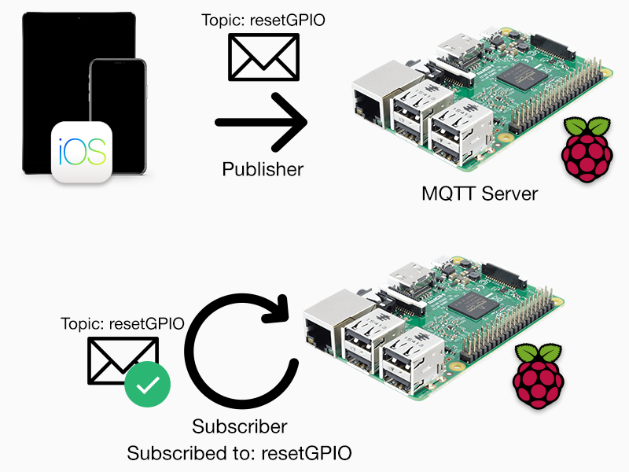
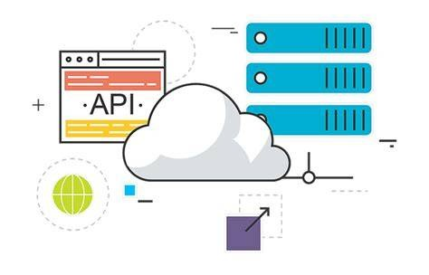

# 📝 Reporte de Actividades - Proyecto IoT Zona 1  
**Fecha:** 29 de agosto de 2025  
**Clase:** Arquitectura de Computadoras y Ensambladores 2  
**Fase:** Planeación y Organización Inicial (Fase 2/Primera Semana)
## Grupo 1 - Tutor 1

| Nombre de los integrantes                   |
|---------------------------------------------|
| MARCOS DANIEL BONIFASI DE LEÓN              |
| ALFREDO EMMANUEL DOMINGUEZ RODRIGUEZ        |
| ALVARO HUMBERTO GARCIA OLIVAREZ             |
| ESTEBAN SANCHEZ TUCHEZ                      |
| JUAN JOSE SANDOVAL RUIZ                     |
| DAVID ESTUARDO BARRIOS RAMIREZ              |
| ENNER ESAÍ MENDIZABAL CASTRO                |
| CARLOS JEZEH GEDEONI TOSCANO PALACIOS       |

---

## ✅ Actividades Realizadas

### 📋 1. Planificación General del Proyecto
- Se revisó el documento oficial de la **Fase 2**, identificando los nuevos requerimientos que se solicitan para llevar a cabo la realización de la Fase 2 del proyecto. Esta vez se implementarán las siguientes tecnologías:
  - Uso de **Raspberry Pi como nodo central e intercomunicador**.  
  - Migración de visualización de datos a **Flutter** y descartar el uso anterior de Processing.  
  - Integración de nuevas tecnologías, además de Flutter, siendo: **API, base de datos y MQTT**.  
  - Inclusión de una pieza **3D impresa** en la maqueta.  
---

### 👥 2. Distribución de Roles y Responsabilidades

#### Tecnologías a implementar:
- Raspberry Pi como nodo central e intercomunicador con Arduino, Flutter, MQTT, etc. 

#
- Flutter para visualización de datos

#
- API, base de datos y MQTT

#
- Realización de la documentación

- Pieza 3D impresa en la maqueta

---

## 👥 Distribución del Trabajo en el Equipo

| Nombre                                      | Actividad                        | Resumen de lo que hará cada uno                                      |
|---------------------------------------------|----------------------------------|---------------------------------------------------------------------|
| MARCOS DANIEL BONIFASI DE LEÓN              | Backend/API, base de datos y MQTT               | Apoyo en desarrollo de API, coordinación de base de datos y comunicación MQTT        |
| ALFREDO EMMANUEL DOMINGUEZ RODRIGUEZ        | Maqueta y documentación          | Optimización de maqueta, cableado y apoyo en documentación          |
| ALVARO HUMBERTO GARCIA OLIVAREZ             | App Flutter                      | Desarrollo de interfaz y lógica en Flutter                           |
| ESTEBAN SANCHEZ TUCHEZ                      | Maqueta                          | Optimización y cableado de maqueta                                   |
| JUAN JOSE SANDOVAL RUIZ                     | App Flutter                      | Desarrollo de interfaz y lógica en Flutter                           |
| DAVID ESTUARDO BARRIOS RAMIREZ              | App Flutter                      | Desarrollo de interfaz y lógica en Flutter                           |
| ENNER ESAÍ MENDIZABAL CASTRO                | Maqueta y documentación          | Optimización de maqueta, cableado y coordinación de documentación como la organización del grupo mismo.     |
| CARLOS JEZEH GEDEONI TOSCANO PALACIOS       | Backend/API y base de datos       | Desarrollo principal de API y apoyo en la realización de la base de datos.                           |

---

### 🗂️ 3. Organización en Herramientas Colaborativas
- Se creó el repositorio en GitHub con la estructura de carpetas por fases. Por lo cual, ya se tiene la carpeta Fase 2 en el repositorio compartido entre colaboradores y el auxiliar Tutor 1 como colaborador por igual. 
- Se establecieron las reglas básicas para commits y ramas en el grupo, dejando la rama main para solo subir el trabajo final. 

---

### 🧭 4. Definición del Cronograma de Trabajo
- Se dividió el trabajo en etapas semanales:
  1. Planeación y organización.  
  2. Optimización de errores pasados en la maqueta. 
  3. Configuración inicial de Raspberry Pi y MQTT junto a nuestro Arduino configurado. 
  4. Diseño de base de datos y primeros endpoints en la API.
  5. Bocetos de interfaz en Flutter. 
  #
- Se estableció una reunión de equipo semanal para dar seguimiento al trabajo y poder estar en comunicación de como vamos avanzando cada uno con el trabajo asignado. 

---

## 📌 Observaciones
- El trabajo se centró en **organización y planeación**, aún sin avances prácticos por parte del grupo además de arreglar los fallos pasados de la maqueta en la Fase 1.  
- Se logró con claridad el organizarnos en los objetivos, roles y metodología de trabajo a llevar a cabo como grupo. 
- El equipo quedó alineado en cómo se integrarán hardware, software y documentación. 

---

## 🚧 Próximas Actividades
- Configuración inicial de **Raspberry Pi** e instalación de **broker MQTT**.
- Elaboración de **diagramas de arquitectura y flujo de datos** para la Fase 2.  
- Realización de la aplicación móvil en **Flutter**.  
- Creación de API y base de datos. 
