# 📝 Reporte de Actividades - Proyecto IoT Zona 1  
Universidad de San Carlos de Guatemala

**Ingeniero**: JURGEN ANDONI RAMIREZ RAMÍREZ
**Tutor:** AXEL ELÍ CALDERÓN BARRIENTOS
**Fecha:** 06 de Septiembre de 2025  
**Clase:** (779) Arquitectura de Computadoras y Ensambladores 2. Seccion B.
**Fase:** Actualización de avances en lo planificado de la semana anterior
## Grupo 1 - Tutor 1

| Nombre de los integrantes                   |
|---------------------------------------------|
| MARCOS DANIEL BONIFASI DE LEÓN              |
| ALFREDO EMMANUEL DOMINGUEZ RODRIGUEZ        |
| ALVARO HUMBERTO GARCIA OLIVAREZ             |
| ESTEBAN SANCHEZ TUCHEZ                      |
| JUAN JOSE SANDOVAL RUIZ                     |
| DAVID ESTUARDO BARRIOS RAMIREZ              |
| ENNER ESAÍ MENDIZABAL CASTRO                |
| CARLOS JEZEH GEDEONI TOSCANO PALACIOS       |

---

##  Registro de Actividades realizadas por cada uno de los integrantes

1. MARCOS DANIEL BONIFASI DE LEÓN:
Realización e inicialización del uso de MQTT y la base de datos, siendo MongoDB Atlas la plataforma que vamos a usar. También, el integrante brindó apoyo en la realización y corrección de errores encontrados en el código de la API que se siguen optimizando.  

2. ALFREDO EMMANUEL DOMINGUEZ RODRIGUEZ: 
El integrante diseño e implementará mejores métodos de encapsulado de los cambles en la maqueta física para las placas de arduino y la Raspberry misma. 

3. ALVARO HUMBERTO GARCIA OLIVAREZ: 
Brindó apoyo en la realización de la aplicación de Flutter ...

4. ESTEBAN SANCHEZ TUCHEZ: 
Brindo apoyo en la corrección de errores en el cableado encontrado en la maqueta física de la Fase 1. 

5. JUAN JOSE SANDOVAL RUIZ:
Apoyo y realización de la pestaña de "Notificaciones" en la aplicación desarrollada de Flutter en app móvil. 

6. DAVID ESTUARDO BARRIOS RAMIREZ:
El integrante comenzó a realizar el código de Flutter en interfaz, lo cual, ya cuenta incluso con una carga local de datos quemados para realización de pruebas que todo se musetra y funciona correctamente. 

7. ENNER ESAÍ MENDIZABAL CASTRO:
Coordinó y se encargó que todos los integrantes del grupo participaran en la realización de las actividades planeadas de la semana pasa o que brindarán apoyo en sus mismas actividades. También, optimizó el código en los buzzers. 

8. CARLOS JEZEH GEDEONI TOSCANO PALACIO:
El integrante brindo apoyo para la realización y optimización en el código de MQTT. El integrante empezó con el Backend/API para comunicarse con MQTT y también, apoyo en hacer la estructura base de la base de datos de MongoDB para enviar con mayor facilidad los datos en mqtt. 

## Conclusiones: 
1. El equipo logró integrar exitosamente tecnologías clave como MQTT y MongoDB, gracias al trabajo colaborativo de Marcos y Carlos, quienes optimizaron la comunicación y la estructura de la base de datos.
2. La maqueta física fue mejorada significativamente en su cableado y encapsulado, con aportes de Alfredo y Esteban, lo que permitirá una mayor estabilidad y facilidad de mantenimiento en futuras fases y semanas. 
3. El desarrollo de la aplicación móvil en Flutter avanzó con la implementación de nuevas funciones, como la pestaña de notificaciones y pruebas locales, gracias al esfuerzo de Juan José, Álvaro y David como supervisor de esta área. 
4. La coordinación y el liderazgo de Enner aseguraron que todos los integrantes participaran activamente y que las tareas se completaran en el tiempo transcurrido de la semana, además que por su parte, él mismo optimizara componentes como los buzzers.
5. El trabajo en equipo permitió corregir errores, mejorar procesos y sentar las bases para una integración eficiente entre hardware y software, asegurando el avance del proyecto en esta fase.

## Observaciones:
1. La colaboración entre los integrantes fue clave para superar los retos técnicos, especialmente en la integración de MQTT y la base de datos.
2. La mejora en el cableado y encapsulado de la maqueta física demuestra el compromiso del equipo por optimizar el hardware y demostrar la profesionalidad con la que se quiera alcanzar en este proyecto de fase. 
3. El avance en la aplicación Flutter refleja una buena distribución de tareas y la capacidad de los integrantes para trabajar en equipo e implementar nuevas tecnologías. 
4. La coordinación y liderazgo dentro del grupo permitió que todos participaran activamente y que todos trabajáran en la semana. 

## Evidencia de trabajo realizado por integrantes: 
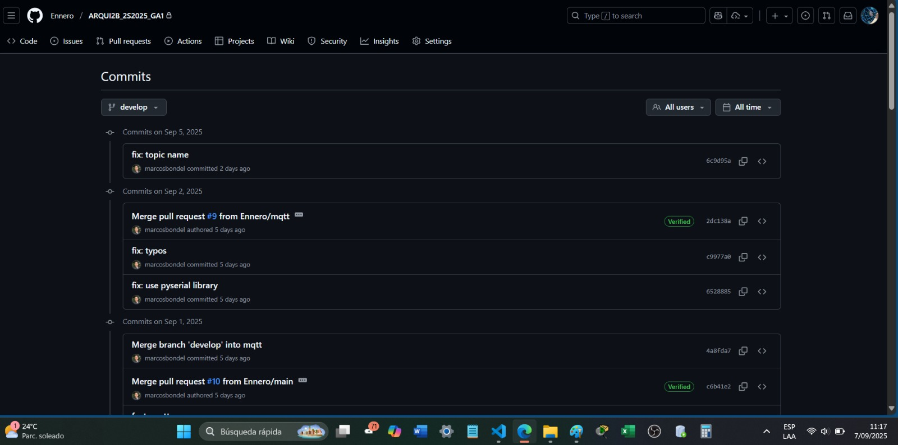
#
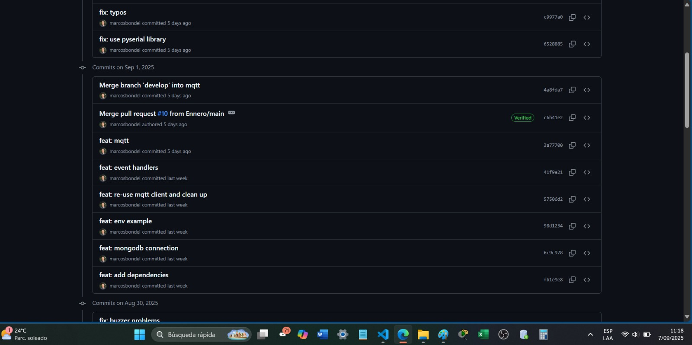
#
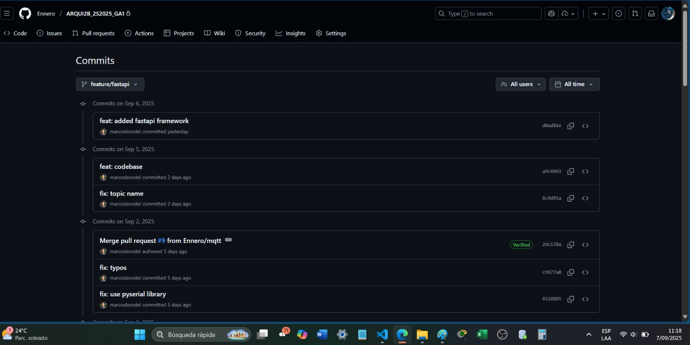
#
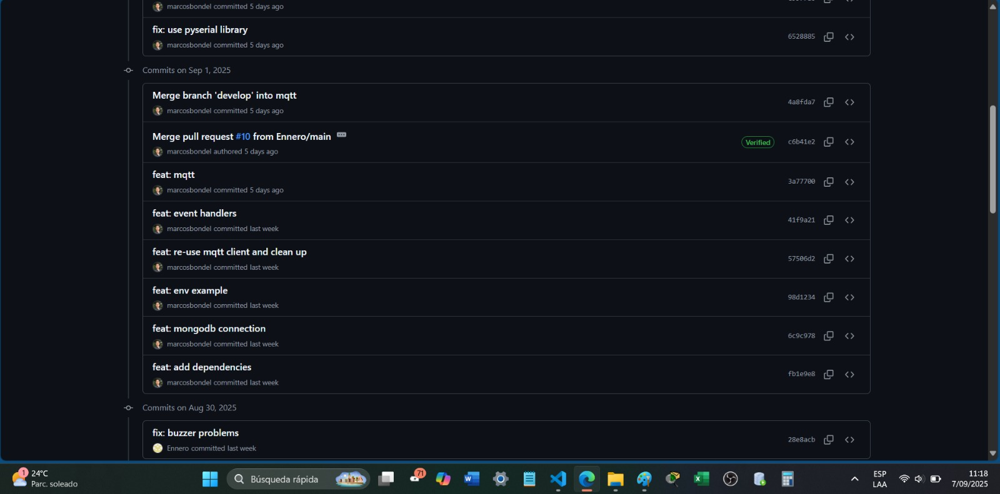
#
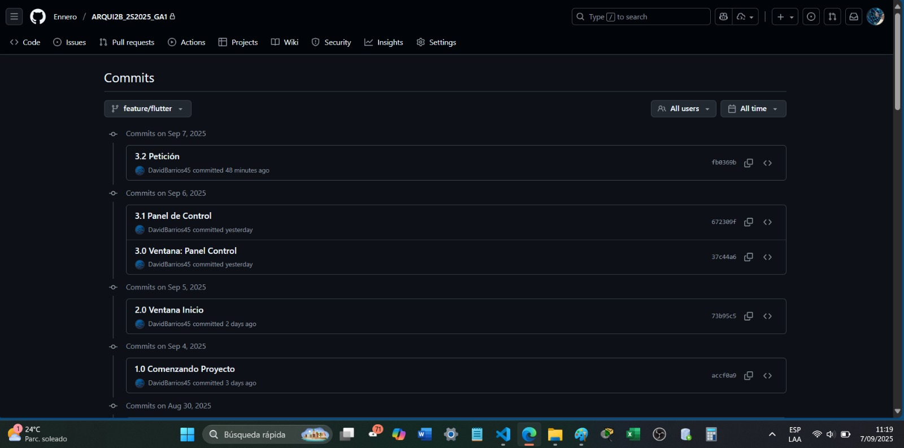
#
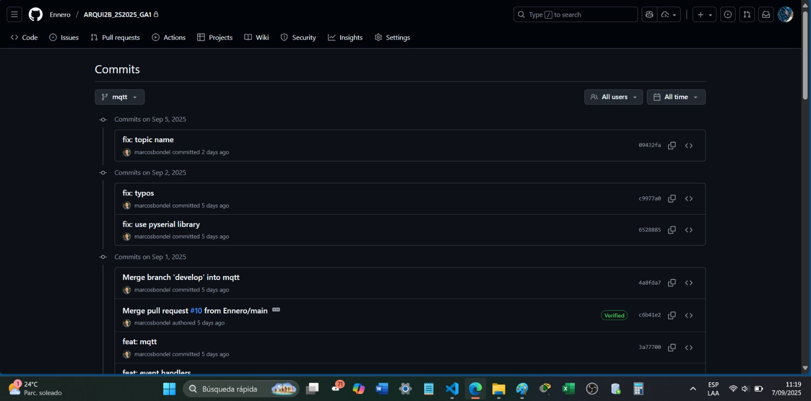
#
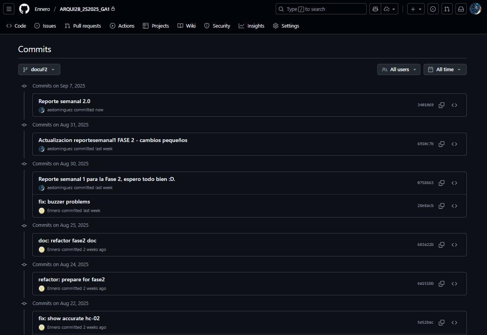
#
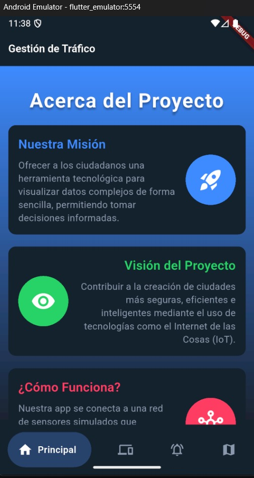
#
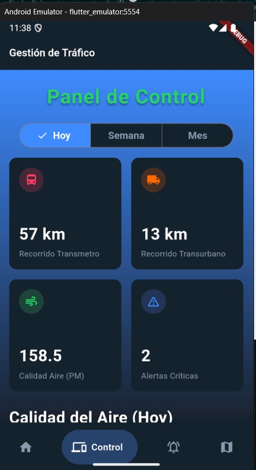
#
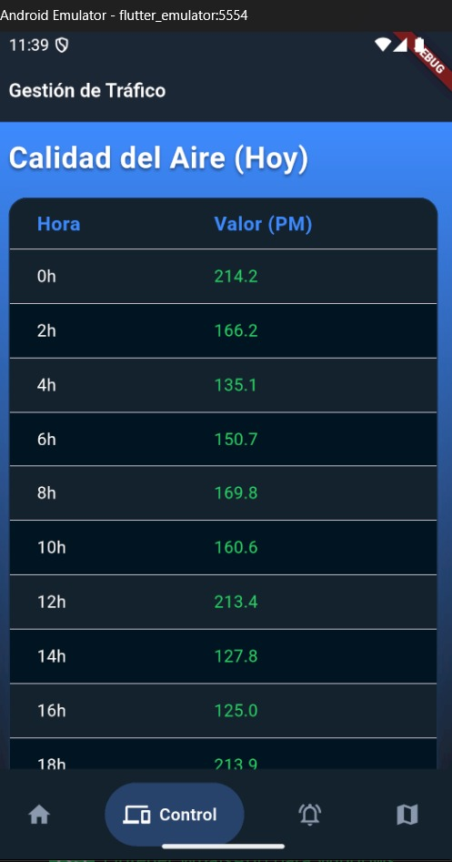
#
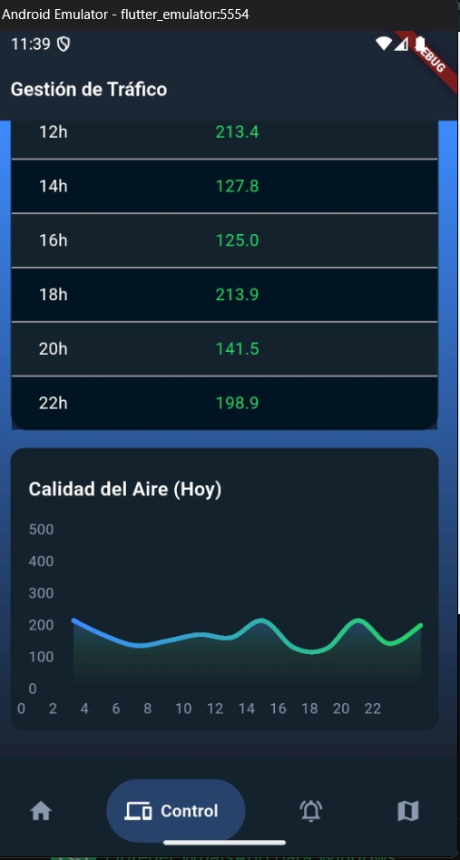
#
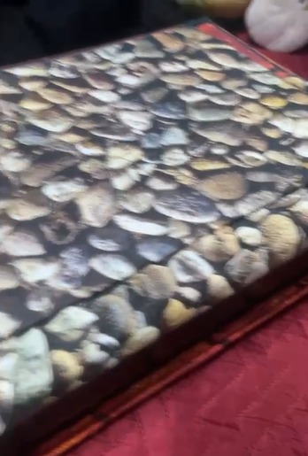