# 📝 Reporte de Actividades Semana 3 Fase 2 - Proyecto IoT Zona 1  
Universidad de San Carlos de Guatemala

**Ingeniero**: JURGEN ANDONI RAMIREZ RAMÍREZ
**Tutor:** AXEL ELÍ CALDERÓN BARRIENTOS
**Fecha:** 06 de Septiembre de 2025  
**Clase:** (779) Arquitectura de Computadoras y Ensambladores 2. Seccion B.
**Fase:** Actualización de avances en lo planificado de la semana anterior
## Grupo 1 - Tutor 1

| Nombre de los integrantes                   |
|---------------------------------------------|
| MARCOS DANIEL BONIFASI DE LEÓN              |
| ALFREDO EMMANUEL DOMINGUEZ RODRIGUEZ        |
| ALVARO HUMBERTO GARCIA OLIVAREZ             |
| ESTEBAN SANCHEZ TUCHEZ                      |
| JUAN JOSE SANDOVAL RUIZ                     |
| DAVID ESTUARDO BARRIOS RAMIREZ              |
| ENNER ESAÍ MENDIZABAL CASTRO                |
| CARLOS JEZEH GEDEONI TOSCANO PALACIOS       |

---

## Actividades Realizadas en esta semana: 
En esta última semana a realizar la segunda fase del proyecto de IoT, ya con todo el trabajo individual que habiamos planificado y que cada integrante nos pusimos a trabajar por separado, esta semana se tuvo el propósito de finalizar cada actividad que cada integrante se le habia propuesto y en el transcurso de la semana, realizar las reuniones que se vieran necesarias para unir todo el trabajo repartido y hacer pruebas que funciona todo en su totalidad y realizar las correcciones de errores. Además, se logró optimizar el encapsulamiento correcto de la maqueta de una forma mas fácil de acceder a las placas de arduino y de la misma raspberry. 

### 1. Actividades realizadas por cada integrante del grupo

| Nombre                                      | Actividades que realizaron        |
|---------------------------------------------|---------------------------------- |
| MARCOS DANIEL BONIFASI DE LEÓN              | Encargado de supervisar e implementación de la base de datos en MongoDB y MQTT.También realizó el Backend/API del proyecto.    |
| ALFREDO EMMANUEL DOMINGUEZ RODRIGUEZ        | Mejora en el encapsulamiento de la Maqueta y encargado en la realización de la documentación                                 | 
| ALVARO HUMBERTO GARCIA OLIVAREZ             | Apoyo en la realización de la App de Flutter                                                                                | 
| ESTEBAN SANCHEZ TUCHEZ                      | Encargado de verificar que todo funcionara correctamente en la Maqueta (cableado en especial) y apoyo en la mejora en el código de los buzzers.                                                        | 
| JUAN JOSE SANDOVAL RUIZ                     | Apoyo en la realización de la App Flutter, especificamente en la ventana de notificaciones.                                    | 
| DAVID ESTUARDO BARRIOS RAMIREZ              | Encargado y supervisor de realizar e implementar correctamente la App de Flutter en la Fase.                                 | 
| ENNER ESAÍ MENDIZABAL CASTRO                | Coordinador encargado de controlar que todos trabajaran en el grupo, dar apoyo y seguimiento en la maqueta física y las actividades de software de la misma, realización y corrección de errores de código de los buzzers y apoyo en la realización de la documentación   | 
| CARLOS JEZEH GEDEONI TOSCANO PALACIOS       | Poco apoyo en la realización de la API para el Backend y en la base de datos. Aunque, debido a su poca participación dentro del grupo, trabajo de forma desordenada y desorganizada, lo cual llevó a tener una mala calidad en el proyecto con una actitud inadecuada; por lo cuál, se decidió sacar del grupo                                      | 

#
#

---

### 1. Mejora en el encapsulamiento: 
Luego de finalizar la primera fase del proyecto, nos dimos cuenta que la forma en la que realizamos el encapsulamiento nos daba más problemas para poder encapsular correctamente los cables y a la hora de mover demasiado los cables de los mismos, podiamos arruinar el circuito ya implementado. Lo que hicimos fue realizar una caja externa la cual se unió al lado de la maqueta para poder guardar las placas de arduino y la raspberry para así, no tener problemas a la hora de tener que verificar algún pin o jumper. Además, con esto no teniamos la necesidad de siempre quitar constantemente las paredes que habiamos puesto anteriormente. 
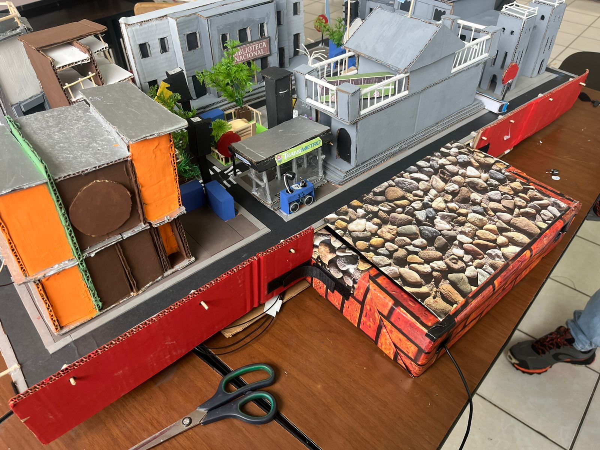
#
#

### 2. Retos a la hora de unir todas las herramientas: 
Al momento de unir todas las herramientas desarrolladas por cada integrante, nos encontramos con varios desafíos técnicos y de coordinación. Fue necesario ajustar la comunicación entre los diferentes módulos, especialmente en la sincronización de datos entre la API, la base de datos y la aplicación móvil. La compatibilidad de versiones y la correcta configuración de los entornos de desarrollo fueron aspectos clave para evitar conflictos. Además, se requirió una revisión minuciosa de los protocolos de comunicación para asegurar que los datos fluyeran correctamente entre los dispositivos IoT y el backend. Las reuniones presenciales y virtuales permitieron resolver dudas y compartir avances, logrando así una integración exitosa de todos los componentes. Finalmente, la colaboración y el compromiso de cada integrante fueron fundamentales para superar estos retos y consolidar el funcionamiento del sistema.

#

### 3. Corrección de errores: 
La forma en la que se llevó el debug de errores fue de suma importancia durante la semana, ya que al unir los diferentes trabajos realizados por todos, surgieron varios inconvenientes inesperados. Nos comunicabamos cada que podiamos para detectar los errores, donde cada integrante que aportó desde su área de trabajo, pudiera identificar y solucionar fallos en el código. Monitoreamos y registramos para poder rastrear los errores y aplicar las soluciones. La comunicación constante permitió que los problemas fueran abordados de manera eficiente, evitando retrasos en la entrega del trabajo. Además, se realizaron pruebas unitarias y de integración para garantizar la estabilidad del sistema. Gracias a este enfoque metódico y al trabajo en equipo, se logró depurar el proyecto y dejarlo listo para su funcionamiento óptimo.

#

### 4. Optimización y corrección de errores en el código de los buzzers
Durante esta fase se optimizó el código de los buzzers. Se configuraron los buzzers para emitir diferentes melodías y alertas según la situación, como por ejemplo, una alarma especial para sismos y otra para el botón de pánico cuando es presionado. Esto permitió que el sistema fuera más intuitivo y funcional para los usuarios, facilitando la identificación de eventos críticos. Se realizaron pruebas exhaustivas para asegurar que los sonidos fueran claros y se activaran en el momento adecuado. Además, se mejoró la eficiencia del código para evitar retrasos o fallos en la activación de los buzzers. 

#

### 5. Retos a la hora de realizar la API/backend
El desarrollo de la API y el backend presentó varios retos, principalmente relacionados con la integración de los diferentes servicios y la gestión eficiente de los datos. Se tuvo que diseñar una arquitectura flexible que permitiera la comunicación fluida entre la base de datos MongoDB, el sistema intermediario MQTT y la aplicación móvil Flutter. La seguridad y el manejo de errores fueron aspectos prioritarios, por lo que se implementaron validaciones y mecanismos de recuperación ante fallos, como lo son el realizar commit y push en el repositorio. Además, se optimizó el rendimiento de las consultas y la transferencia de datos para garantizar una experiencia rápida y estable para el usuario. Con esto, se logró construir una API robusta y escalable que cumple con los requerimientos del proyecto.

---
#
#

## Observaciones a lo largo de la semana: 
- Todos los integrantes del grupo trabajaron de la mejor manera posible cada uno por separado, ya que esta fase se realizó por su mayoría en el campo de su software, por lo cual, no nos llevó el juntarnos varias veces a la semana y cada quien, dependiendo su horario disponible, trabajaba y avanzaba como se le hacia posible. Además, si era necesario el juntarnos fisicamente para realizar correcciones de errores y para unir los componentes, pues un día antes nos organizabamos y las personas encargadas de venir pues se hacian presente para trabajar en grupo y terminar la fase del proyecto. 
- Cada integrante lograba participar para poder aportar ideas, comentarios y mejoras para poder mejorar la maqueta de la mejor manera posible (agrega un poco mas de texto aqui xd)

#
#

## Evidencia: 
#
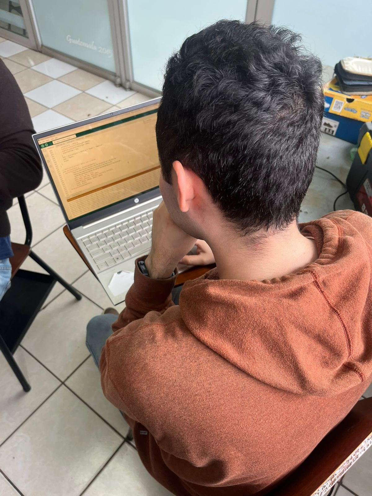
#
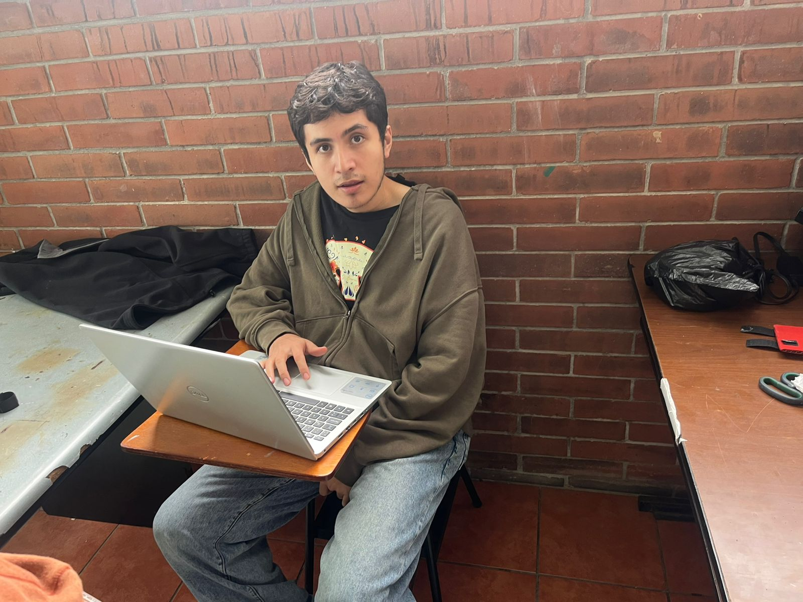
#
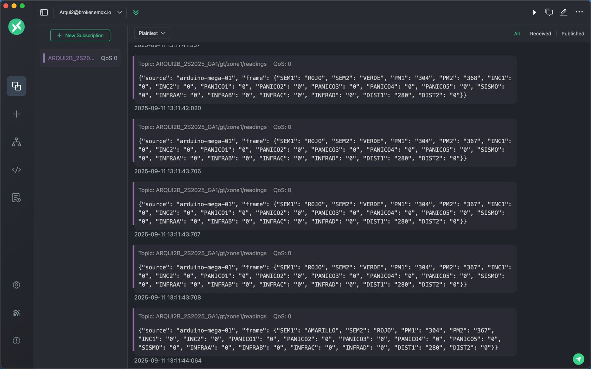
#
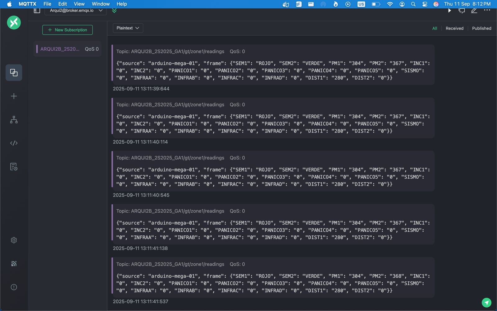
#
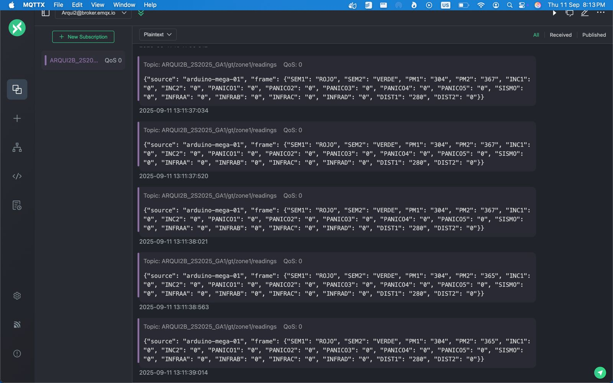
#
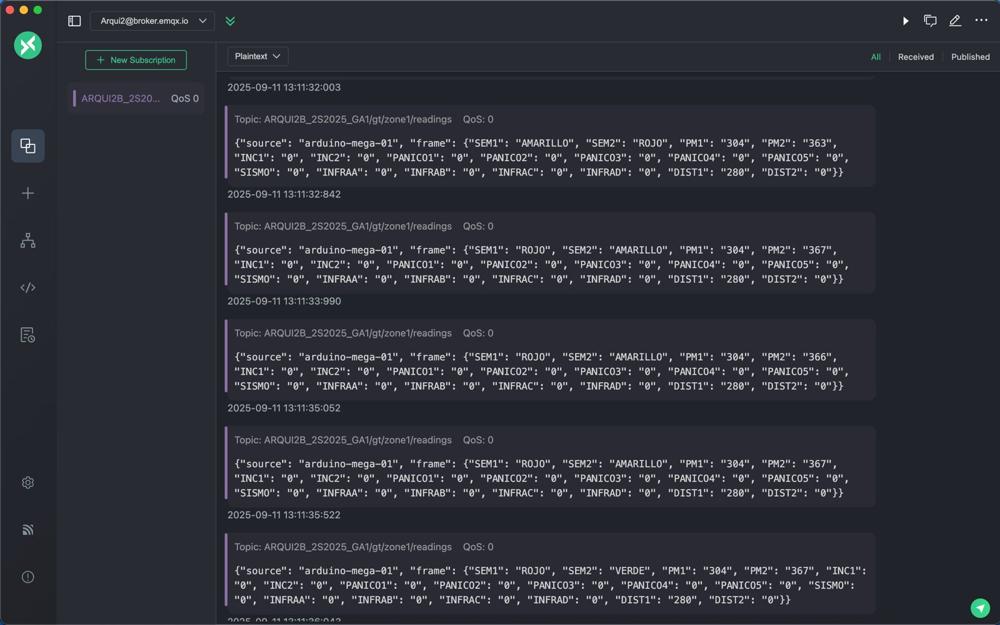
#
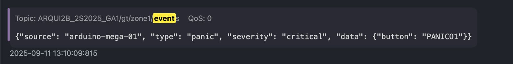
#
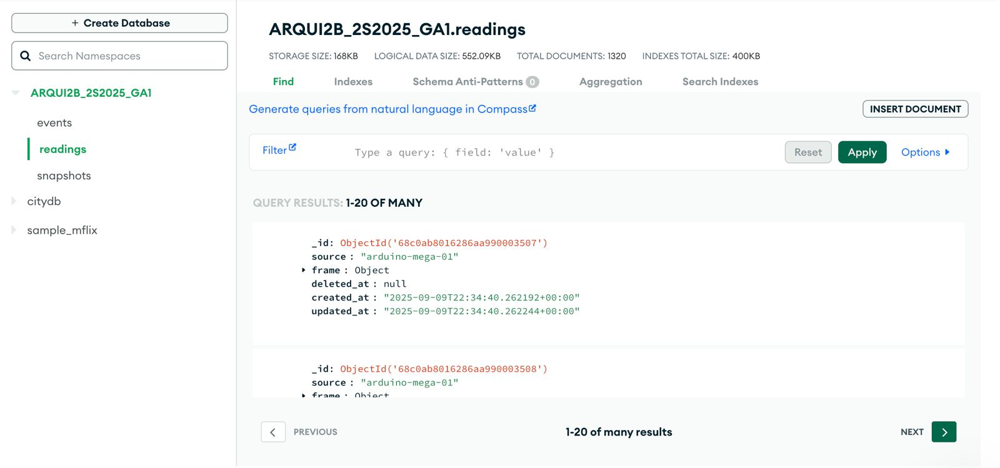
#
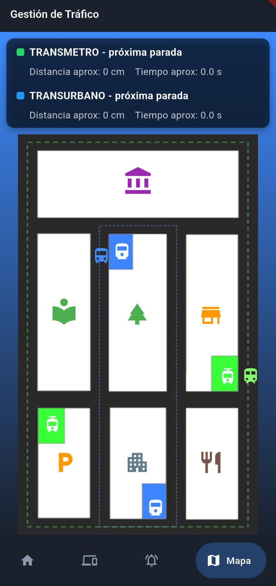
#
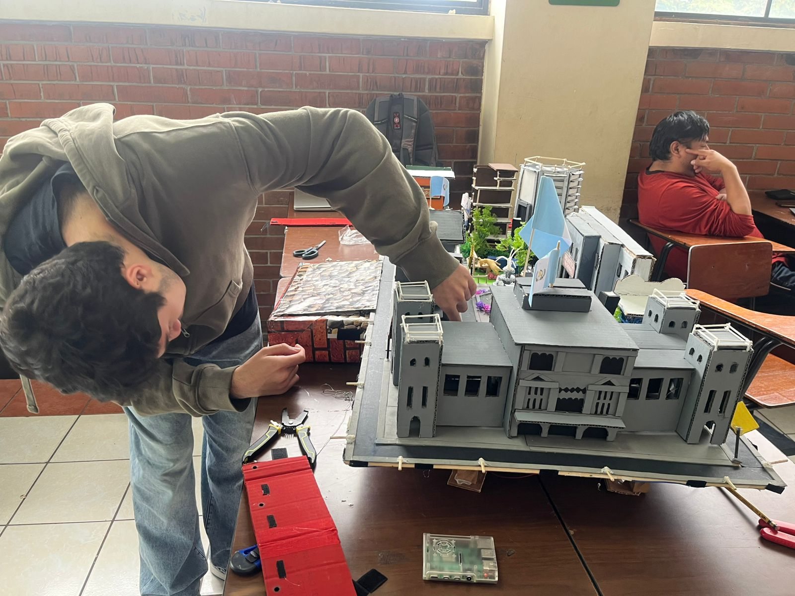
#
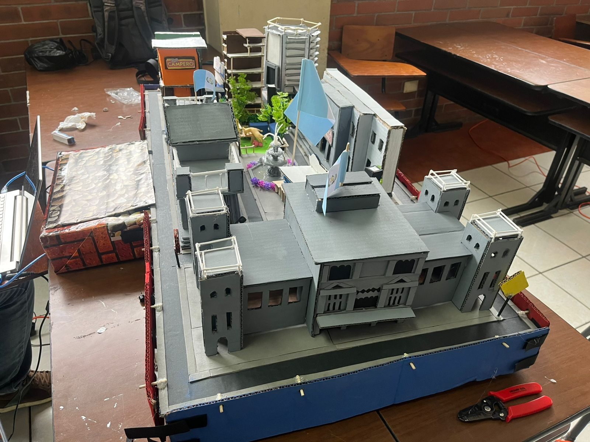