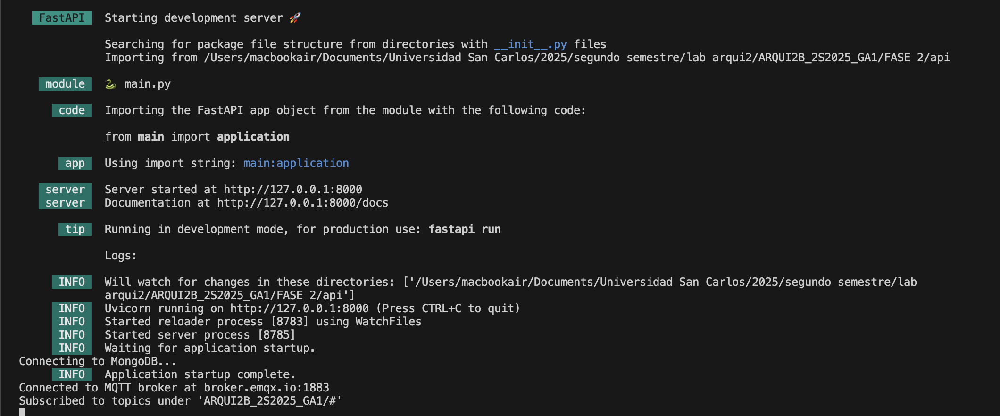

# API

**Python version 3.13.4**

### Installation guide

First, ensure you the respective `.env` file with the correct credentials according to your execution environment placed at the root of this location.

#### Create Virtual Environment
```bash
    # Create Virtual Enviroment
    python3 -m venv .venv

    # For bash terminal in windows
    python -m venv .venv
```

#### Activate Virtual Environment
```bash
    # Linux/MacOS
    source .venv/bin/activate 
    # Windows powershell
    .venv\Scripts\Activate.ps1
    # Windows bash
    source .venv/Scripts/activate
```

#### Install packages
```bash
    # Install Python packages from the requirements.txt
    pip3 install -r requirements.txt

    # For windows bash terminal
    pip install -r requirements.txt
```

#### Run App

The recommended way to run the app for development is with uvicorn, as it provides live reloading.

```bash
    # Run App
    fastapi dev main.py
    # New way with CORS
    uvicorn main:application --reload --port 8000
```

*You should get an output like this:*




### Endpoints

### Analytics
```
GET /analytics/daily
GET /analytics/daily?day=2025-09-09

GET /analytics/weekly?day=2025-09-09

GET /analytics/monthly
GET /analytics/monthly?year=2025&month=9

GET /analytics/infractions-today
GET /analytics/top-persons?limit=5
GET /analytics/top-weapons?limit=5

```

### Bus tracking
```
GET /live/bus/distances
```

### Notifications

```
GET /notifications
GET /notifications?severity=critical
GET /notifications?types=panic,infraction
GET /notifications?types=person_on_blacklist,bladed_weapon
GET /notifications?since=2025-09-05T16:00:00Z
```
