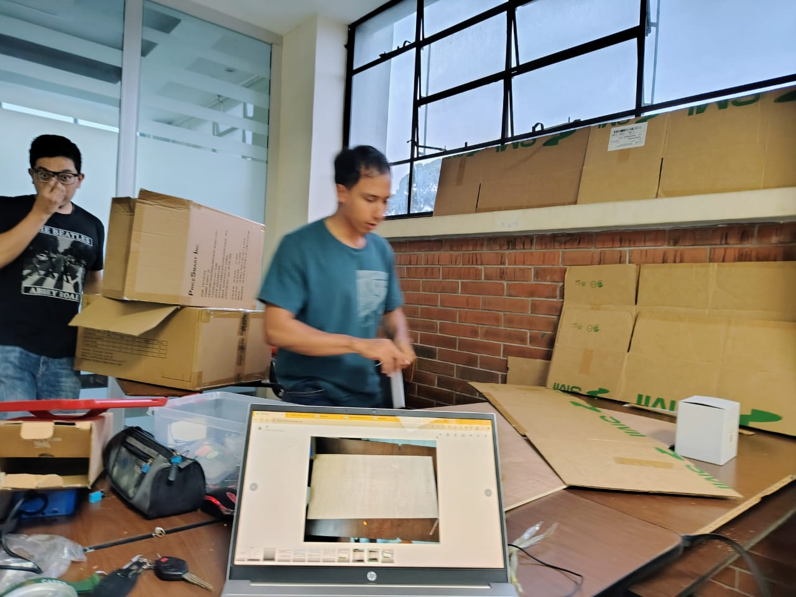
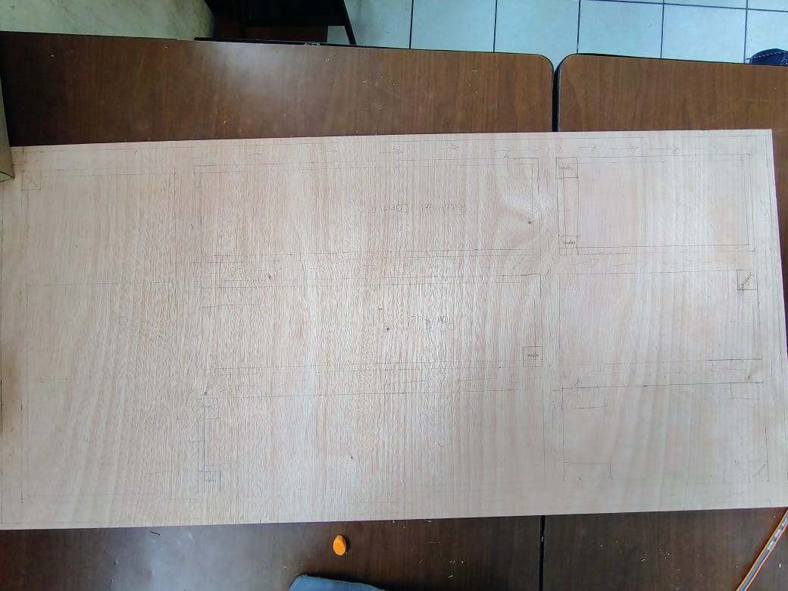
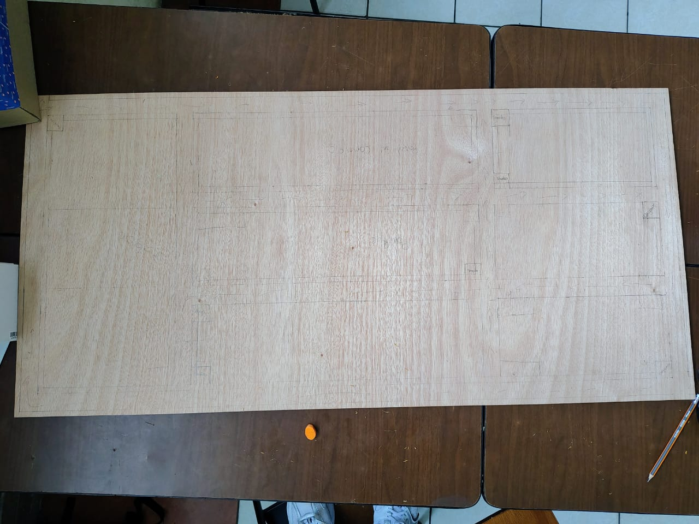
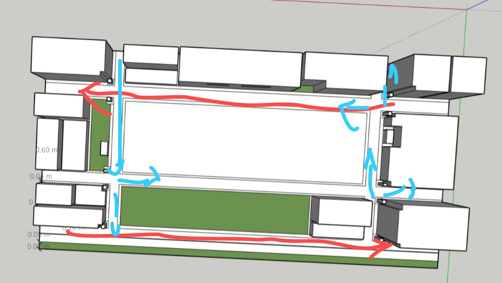
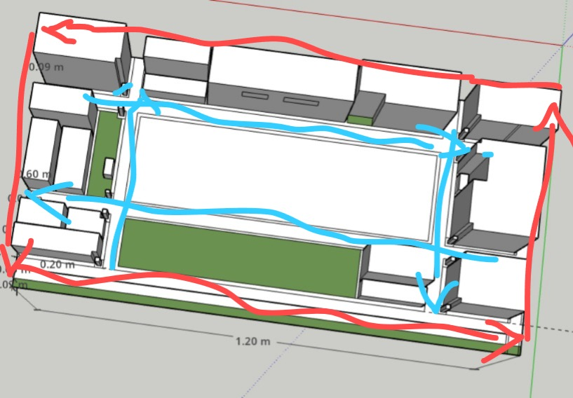
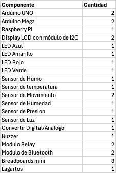

# 📝 Reporte de Actividades - Proyecto IoT Zona 1
**Fecha:** 5 de agosto de 2025  
**Equipo:** Arquitectura de Computadoras y Ensambladores 2  
**Fase:** Diseño y preparación inicial (Fase 1)

---

## ✅ Actividades Realizadas

### 🏗️ 1. Inicio del Diseño de la Maqueta Física
- Se inició la construcción de la maqueta a escala representando **6 cuadras del Centro Histórico**.
- Se delimitó la ubicación de:
  - 2 paradas de Transmetro
  - 2 paradas de Transurbano
  - 2 puntos históricos

**Captura del avance:**  
<<<<<<< HEAD

=======

>>>>>>> develop

---

### 🖥️ 2. Diseño Digital en SketchUp
- Se desarrolló el **modelo 3D de referencia** en SketchUp, usando como base el mapa del Centro Histórico.
- El diseño permite una visualización previa para definir ubicación de sensores, botones de pánico y semáforos.

**Vista preliminar del modelo:**  
https://app.sketchup.com/share/tc/northAmerica/aJ2IbRWgOl0?stoken=XyzgiDlDwOA2tYNCufjUEXr-pC4gbiujco70CVSAYh1IWYxRf9vRuN2l5BS9yo0-&source=web

<<<<<<< HEAD

=======

>>>>>>> develop

---

### 🛒 3. Componentes Electrónicos

<<<<<<< HEAD
=======

>>>>>>> develop

---

## 👥 Distribución del Trabajo en el Equipo

| Integrante         | Actividad Realizada                                                                 |
|--------------------|--------------------------------------------------------------------------------------|
| David, Alfredo, Juan José | Construcción de edificios físicos de la maqueta                              |
| Álvaro             | Conseguir y gestionar el material de trabajo                                        |
| Enner y Carlos (modelado) | Diseño digital en SketchUp, organización espacial y simulación del entorno urbano   |
| Esteban, Marcos, Tú| Revisión y pruebas de sensores (HC-SR04, MQ-2, piezo), conexiones y cableado        |

## 📌 Observaciones
- Se verificó compatibilidad de sensores con Arduino.
- Se están considerando los umbrales de los sensores para programarlos correctamente.

---

## 🚧 Próximas Actividades
- Finalizar base de la maqueta
- Probar sensores HC-SR04 con LEDs
- Implementar comunicación entre Arduino Master y Slaves
- Iniciar el dashboard en **Processing**

---
