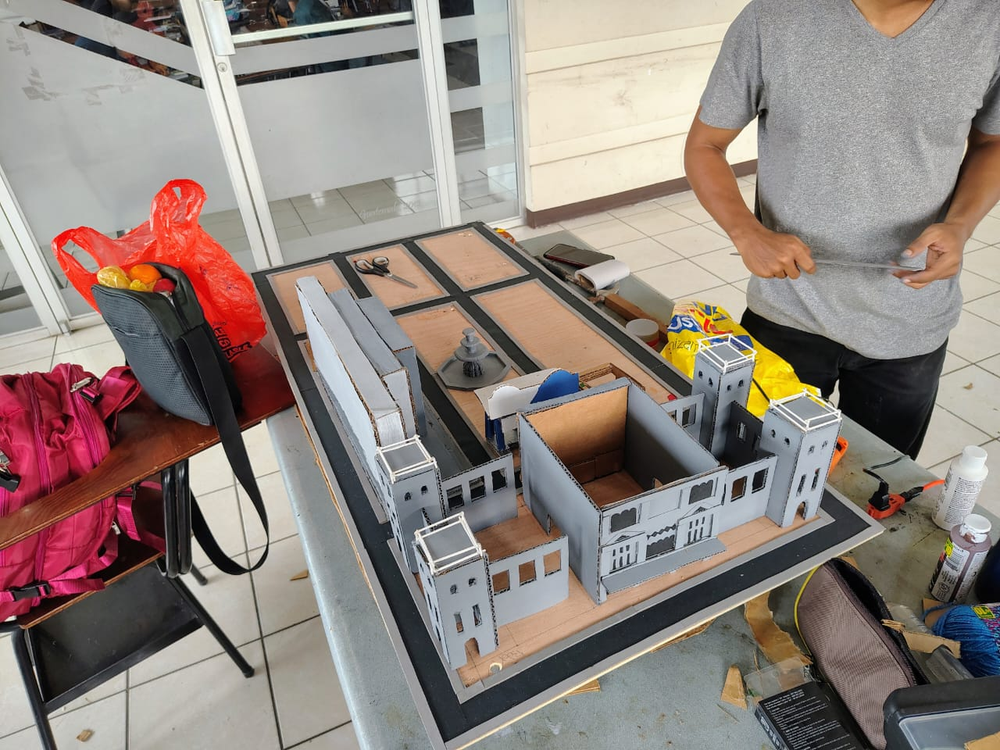

# 📊 Reporte Semanal de Avances - Proyecto Fase 1

**Semana:** 2  
**Fecha de entrega:** 23/08/2025  
**Grupo:** 1 

---

## 👥 Registro de Actividades por Integrante

### 1. Marcos  
- Instalación y configuración de sensores.  
- Conexión de dispositivos a la maqueta.  

---

### 2. Enner  
- Apoyo general en el ensamblaje y construcción de la maqueta.  

---

### 3. Esteban  
- Cableado estructurado de la maqueta.  
- Integración de conexiones con los diferentes dispositivos.  

---

### 4. Juan  
- Cableado eléctrico de la maqueta.  
- Soporte en la interconexión de dispositivos.  

---

### 5. David  
- Desarrollo y montaje de la estructura principal de la maqueta.  

---

### 6. Alfredo  
- Construcción física de la maqueta.  
- Detalles de diseño y soporte en el ensamblaje.  

---

### 7. Álvaro  
- Colaboración en la construcción de la maqueta.  
- Apoyo en el cableado y distribución de conexiones.  

---

### 8. Carlos Toscano  
- Apoyo en la documentación técnica del proyecto.  
- Desarrollo y ajuste del código de integración.  

---

## ✅ Conclusiones de la Semana
Durante esta semana se alcanzaron los siguientes resultados:  
- Integración exitosa de los sensores y semáforos en la maqueta.  
- Avance en la construcción física con edificios decorados y ubicados en su posición final.  
- Cableado completo de los dispositivos hacia las diferentes protoboards.  
- Ejecución de pruebas en **Processing**, verificando la correcta visualización de datos en el dashboard.  
- Avance general tanto en la parte técnica como en la parte estética del proyecto.  

---

## 📅 Plan de Trabajo para la Próxima Semana
- Finalizar la **Fase 1** del proyecto con todos los sensores y dispositivos funcionando correctamente.  
- Asegurar la comunicación estable entre la maqueta y el dashboard de **Processing**.  
- Mejorar detalles estéticos de la maqueta para su presentación.  
- Continuar con pruebas de integración y optimización del cableado.  

---

## 📸 Evidencias

---
